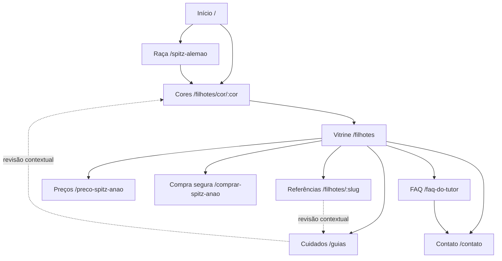

# By Império Dog — auditoria e implementação local

Data de referência: 03/11/2026, America/Sao_Paulo. Branch: `codex/seo-organico-2026-11-03`. Base Git: `4e3f4b436530f5bfe7191343df265085ba6f7f79`.

## Resultado e limites

Implementados: busca estruturada em linguagem natural na vitrine; estados acessíveis dos filtros; seis ligações educativas no catálogo; seção ampla com acesso ao perfil original do Google; auditoria pública reproduzível e inventário dos 30 artigos MDX. Sem nova dependência ou chamada paga na busca. Nada publicado, nenhum anúncio alterado e nenhum contato enviado.

A especificação completa **não está concluída**: cards/notas Google dependem de fonte autorizada; revisão comercial depende de aprovação; Search Console/Ads/GA4 dependem de acesso; estoque individual confirmado não existe nesta fonte estática. Não houve reescrita de contratos, preços, fotografias, depoimentos ou status. Não há evidência para prometer posições, indexação, aumento de vendas ou recomendações de IA.

O checkout já continha muitas alterações. `initial-status.txt` registra os arquivos anteriores; `baseline/` guarda as versões anteriores dos três arquivos de aplicação editados nesta rodada. Essas alterações prévias não são resultados deste trabalho. O site público e o checkout diferem; não publicar o conjunto inteiro sem revisar essa divergência.

## Diagnóstico comprovado

- Stack: Next.js 16.3.3 App Router, React 19, TypeScript, Tailwind, MDX; Supabase para dados; arquivos estáticos para vitrine; rotas administrativas; configuração de hospedagem Netlify e Vercel. Existem SSR/SSG, canonicals, sitemap de artigos/imagens/vídeos, breadcrumbs e schemas. Não é necessário reconstruir o site.
- Build local: nove referências de catálogo, sete divulgadas e duas fora da vitrine. Há IDs estáveis; não há estoque confiável nem nascimento individual nessa fonte. A versão pública observada tem diferenças de catálogo e de metadados. Comparar preços apenas pelo mesmo ID/animal, nunca pela cor ou sexo.
- Homepage, catálogo, raça, contato e FAQ responderam 200 na coleta HTTP. O HTML contém H1 e conteúdo, sem depender inteiramente de JavaScript. Nas páginas amostradas, nenhuma imagem ficou sem atributo alt; isso não certifica a qualidade de cada descrição.
- `/preco-spitz-anao` redirecionou em produção para `/filhotes`; no código local há página própria com canonical próprio. Investigar a regra da hospedagem e o histórico antes de restaurar/remover qualquer URL. Não se conclui canibalização só pela existência de duas páginas.
- `robots.txt` permite páginas públicas a buscadores e bots de busca com IA e repete exclusões privadas. Robots não substitui autenticação. Os testes de segurança existentes foram executados; não houve pentest nem verificação da infraestrutura remota.
- Publicação ainda usa linguagem de criação própria, inclusão universal de documentação/exames e entrega nacional. Isso exige revisão conforme os fatos fornecidos pela proprietária. Propostas abaixo; texto comercial existente preservado até aprovação.
- Integração Google não identificada no checkout: `TextTestimonials` tem depoimentos próprios; `/api/reviews` lê `puppy_reviews` do Supabase; `domain/config.ts` contém links Google. Não há prova de que esses depoimentos vieram do Google. Nenhum foi renomeado como avaliação Google.
- O prebuild identificou reutilização de três fotos entre fichas pretas e de um vídeo em três fichas. Isso é alerta para verificar identidade/autorização, não comprovação de cadastro errado. Fotos preservadas.

## Matriz competitiva

Evidência técnica completa em `public-audit.json`: URL, URL final, HTTP, canonical, title, description, H1–H3, tipos de schema, links e robots/sitemap. É uma amostra de páginas, não crawl integral dos domínios. Impacto é estimativa qualitativa, não previsão de ranking. Esforço: baixo até um dia; médio 2–5 dias; alto depende de integração/dados.

| Elemento / URL Flor do Tijuco | Função e evidência | Equivalente By Império Dog / lacuna | Prioridade e proposta original |
|---|---|---|---|
| [Home](https://flordotijuco.com.br/) | 13 links de cores; bloco Google com Trustindex e contagem exibida de 128 na consulta pública | Home já liga quatro cores divulgadas e fichas; falta fonte Google identificada | Alta, médio: seção ampla com fonte autêntica. Não copiar avaliações nem ampliar estoque fictício |
| [Raça](https://flordotijuco.com.br/sobre-a-raca/) | Guia com navegação por padrão, comportamento, saúde e história | `/spitz-alemao`, `/lulu-da-pomerania`, `/guias` e artigos cobrem os temas | Alta, médio: revisar originalidade, fontes e ligações contextuais; revisão veterinária onde pertinente |
| [Preto](https://flordotijuco.com.br/spitz-alemao-preto/) | Página temática; amostra sem H1 e com muitas seções geográficas | `/spitz-alemao-preto` e `/filhotes/cor/preto` já existem | Média, baixo: distinguir informação sobre cor de consulta à vitrine; não copiar blocos de cidades |
| [Catálogo](https://flordotijuco.com.br/filhotes-a-venda/) | Acesso comercial a fichas individuais | `/filhotes` é vitrine de referências, sem inventário confirmado | Alta, alto para estoque; busca local implementada, sem inventar disponibilidade |
| [Ficha Bad Bunny](https://flordotijuco.com.br/filhote-spitz-alemao-bad-bunny/) | Seções de informações, vídeo e pais; canonical aponta a outra ficha (`…-waze/`) | Fichas locais têm IDs e galerias, mas não documentação individual validada | Alta, médio: dados por animal e status confirmados. Não imitar canonical entre animais diferentes |
| [Arquivo de vendidos](https://flordotijuco.com.br/category/filhote-vendido/) | Histórico com link de paginação | Referências permanentes, não histórico verificado de vendas | Média, alto: conservar URLs; histórico só após mapear registros a animais reais |
| [FAQ](https://flordotijuco.com.br/duvidas-frequentes/) | Respostas comerciais e contato | `/faq-do-tutor`, FAQ home e catálogo | Alta, baixo: revisar promessas e remeter às condições do animal específico |
| [Blog](https://flordotijuco.com.br/blog/) | Arquivo editorial também contém fichas de filhotes | 30 MDX locais mais fonte Supabase | Média, médio: atualizar artigos existentes. Volume de páginas não comprova autoridade |
| [Robots](https://flordotijuco.com.br/robots.txt) e [sitemap](https://flordotijuco.com.br/wp-sitemap.xml) | Sitemap WordPress responde 200 | Robots e sitemap Next já existem | Alta, baixo: conferir destinos finais; `/sitemap_index.xml` deu 404 nos concorrentes, mas não é o sitemap declarado |
| Titles e descriptions da amostra | Flor tem títulos e descrições específicos; segundo domínio sem description nas duas páginas HTML verificadas | By tem títulos/canonicals na amostra, com diferenças entre produção e checkout | Alta, médio: proposta comercial consistente antes de sincronizar versões |
| Breadcrumbs/schema | Flor expõe BreadcrumbList/Organization/WebSite; presença não garante validade completa | By expõe BreadcrumbList, ItemList, CollectionPage, LocalBusiness e WebSite | Média, baixo: conservar apenas fatos verificáveis; nenhuma avaliação agregada adicionada |
| Imagens, vídeo e mobile | Há mídias e seções próprias; não foram medidos CWV de campo do concorrente | Imagens Next, formatos modernos e vídeo já implementados | Alta, médio: medir p75 e custo dos recursos, sem concluir que HTML menor é site mais rápido |
| Autoridade/backlinks | Perfil completo de links não obtido | Sem dados comparáveis de domínios de referência | Pendente: Search Console/serviço autorizado, sem compra de backlinks |
| Local/reputação | Flor informa Cotia; segundo domínio repete telefone e cidade | By informa Bragança Paulista, perfil Google e Instagram no código | Alta, médio: validar NAP e horários com o perfil autorizado; não abrir unidades fictícias |

### Segundo domínio

[luludapomerania.com.br](https://luludapomerania.com.br/) respondeu 200 sem redirecionar à home Flor, com canonical próprio. Seu [catálogo](https://luludapomerania.com.br/filhotes-a-venda/) liga ao catálogo Flor. Logo identificado, telefone público, cidade e avaliações em comum sustentam vínculo comercial; propriedade registral não foi verificada. São páginas próprias, com sobreposição temática, não uma simples cópia por redirect. Não há dados de consultas para medir competição entre os domínios ou ganho incremental. Não recomendar segundo domínio para By apenas por esse exemplo.

## Arquitetura e ligações

Seis links adicionais no catálogo foram implementados usando o componente servidor `RelatedPages`. Linhas pontilhadas indicam expansão proposta após revisão editorial. Não criadas páginas artificiais de cidades, cores disponíveis ou centenas de combinações. Bragança é a sede; Atibaia/Campinas/São Paulo entram somente com conteúdo útil e confirmação do atendimento.

## Busca, catálogo e voz

`catalog-query.ts` interpreta cor, sexo e teto em reais (7.500, 7500, 7,5 mil), orienta localização/reserva/documentos e reconhece pedido de disponibilidade. Filtra os dados recebidos pelo catálogo; mantém preço individual e filtros tradicionais. Cor inexistente retorna zero referências. Negação, intervalo não suportado e texto desconhecido pedem reformulação. Não é um modelo generativo nem entende qualquer frase. A contagem é de referências da vitrine, jamais de animais disponíveis. Nenhuma consulta é armazenada ou enviada a terceiros por este recurso.

Voz **já existia** em `AiMatchmakerChat`: MediaRecorder, autorização de microfone, trechos até 15 segundos, POST `/api/transcribe`, Groq Whisper, resposta textual e speechSynthesis pt-BR, interrupção manual e alternativa por texto. API tem limite de tamanho e taxa no estado local existente. Não houve chamada paga nem gravação de áudio nesta auditoria. Pendências: verificar consentimento informado sobre envio externo; cancelamento durante getUserMedia/transcrição; limpeza no unmount; erro de API sem repetição ilimitada; timer de síntese que pode falar duas vezes; testes em Safari/iOS e Android reais; teto global de custos. Planejar voz sobre o parser estruturado antes de ampliar conversa generativa.

Alternativas: digitação (implementada, zero custo de API); ditado do teclado do dispositivo; Web Speech opcional com cobertura/privacidade dependentes do navegador; reaproveitamento do serviço existente após autorização de custos. Groq publica US$ 0,04/h para Whisper Large v3 Turbo; 100 h de áudio faturável seriam US$ 4 de transcrição, sem incluir mínimos por requisição, chat, câmbio, impostos e hospedagem. [Preço e limites oficiais](https://console.groq.com/docs/speech-to-text). Nenhum orçamento contratado.

## Google: dados e mensuração

Não houve acesso autenticado às contas Google nesta rodada. Foi identificado Windsor.ai como integração possível; não está confirmado como instalado/conectado. A conexão Meta disponível é restrita a Facebook, não serve como acesso a Ads/GA4/Search Console.

O runbook local de agosto descreve GTM, GA4 e conversão de clique WhatsApp. Trata-se de registro histórico, não leitura atual. Código tem consentimento, separação GTM/gtag e transaction ID opcional. `gclid.ts` aceita GCLID/WBRAID/GBRAID, mas guarda somente o valor, perdendo o tipo; usa sessionStorage antes de consentimento e localStorage por 90 dias com marketing. Antes de importação offline, revisar base de tratamento/consentimento, revogação, retenção e armazenamento do par `{type,value}`. Não inferir conformidade legal pelo uso de sessionStorage.

| Etapa | Evidência necessária | Uso proposto |
|---|---|---|
| page_view | página vista | audiência, não lead |
| view_item | ficha vista / ID de referência | interesse, não venda |
| whatsapp_click | clique no link | microconversão; não prova conversa |
| conversation_started | mensagem recebida confirmada por canal/CRM | contato real |
| qualified_lead | critério humano: interesse, condições e intenção compatíveis | possível otimização após volume suficiente |
| reservation_confirmed | reserva registrada e confirmação comercial | valor real quando aplicável |
| sale_completed | venda conciliada | receita real, deduplicada |

Proposta offline: tabela protegida com `lead_id`, `event_id`, `click_id_type`, `click_id`, ação, data/hora com fuso, valor, BRL, origem e prova/estado de consentimento. Deduplicar por evento/ação e manter reconciliação de cancelamentos. Não enviar mensagem, nome ou telefone em eventos de navegação. Dados pessoais eventualmente necessários para Enhanced Conversions exigem fluxo autorizado, normalização/hash e políticas da plataforma; hash não torna dados anônimos.

Comparação: Data Manager/Enhanced Conversions é o caminho oficial, exige dados de primeira parte, configuração e manutenção; CRM/planilha reduz dependência de fornecedor, mas exige conciliação operacional; Cagueta permanece sem identificação/documentação oficial verificável nesta pesquisa, portanto preço, segurança e capacidades não foram presumidos. Não comprar ferramenta antes de validar exportação, deduplicação, integração oficial, retenção e custo. [Orientação oficial Google](https://support.google.com/google-ads/answer/15713840?hl=en-AU).

### Exportações necessárias

No Search Console, selecionar a propriedade correta → Desempenho → Resultados da pesquisa → Web. Exportar consultas, páginas, datas, países e dispositivos para 3, 6 e 12 meses completos, com comparação ao período anterior; guardar filtros e datas exatas. Separar marca/não marca, compra, cor e localização. Para consultas prioritárias, filtrar consulta e exportar páginas, ou obter dimensões consulta+página pela API para não perder a relação. Filtrar posições médias 4–20 e impressões relevantes; comparar CTR por dispositivo e intenção, sem usar posição média como posição fixa. Exportar indexação, motivos de exclusão, sitemaps e CWV; inspecionar amostra das URLs críticas.

GA4: páginas de entrada por canal/dispositivo, eventos e consentimento; Google Ads: termos reais, correspondências, negativas, redes, locais, dispositivos, horários, custo, ações de conversão e atribuição. Reconciliar contatos/reservas/vendas com a operação. O relato de R$ 200 em três dias não permite concluir configuração incorreta. Nenhuma mudança de campanha ou conversão principal autorizada nesta rodada.

## Propostas comerciais para aprovação — não aplicadas

| Onde | Texto proposto |
|---|---|
| Title home | Spitz Alemão Anão em Bragança Paulista — By Império Dog |
| Description home | By Império Dog: comercialização especializada de Spitz Alemão Anão desde 2013 em Bragança Paulista. Conheça a vitrine e consulte as opções atuais. |
| Hero | Especialistas em Spitz Alemão Anão / Lulu da Pomerânia desde 2013. Atendimento personalizado em Bragança Paulista, SP. |
| Sobre/origem | Comercializamos filhotes adquiridos de terceiros. A origem e as informações de cada animal são apresentadas individualmente no atendimento. |
| Botões | Falar com a equipe |
| Documentação | Consulte os documentos, registros sanitários e condições aplicáveis ao filhote escolhido antes de reservar. |
| Logística | Consulte com a equipe as possibilidades de retirada e as condições aplicáveis à sua localidade. |
| Acompanhamento | Atendimento e acompanhamento conforme as condições comerciais e contratuais acordadas. |
| Catálogo metadata | Conheça fotos e valores individuais de Spitz Alemão Anão. Consulte as opções atuais com a By Império Dog em Bragança Paulista, SP. |

Aplicar coerentemente em home, hero, catálogo, páginas educativas, FAQ, footer, BRAND e JSON-LD depois de aprovar. Confirmar separadamente o que realmente inclui pedigree/registro, exames, vacinas e acompanhamento; não substituir por novas garantias universais. Razão social não deve ser inferida do nome comercial.

## Editorial e SEO local

`editorial-inventory.json` inventaria todos os 30 MDX: título, extensão aproximada, headings, links e ocorrências para revisão de alegações. O quality gate existente aprovou os 30 estruturalmente; isso não é revisão clínica nem prova de demanda. Posts apenas no Supabase não foram integralmente auditados. Não criar mais artigos de preço/cores antes de avaliar as URLs existentes.

Calendário provisório, condicionado aos dados de busca: semanas 1–2 revisar compra segura e documentação; semanas 3–4 revisar preço individual e relação Spitz/Lulu; mês 2 atualizar adaptação/escovação/socialização com revisão técnica; mês 3 revisar FAQ local e dúvidas comerciais observadas nos contatos. Prioridade final depende de impressões, consultas e conversas reais, não volume inventado.

Rascunho para documentação: “Antes de reservar, peça as informações do filhote escolhido e confirme quais documentos serão entregues e em que prazo. Compare os dados do animal com o contrato e esclareça as condições de acompanhamento. Características de cor ou sexo não substituem essa conferência.” Linkar guia existente e contato; não publicar automaticamente.

Rascunho local: “A By Império Dog está em Bragança Paulista, São Paulo. Se você está em Atibaia, Campinas ou na capital, converse com a equipe para conhecer as condições aplicáveis ao seu atendimento e combinar uma eventual visita.” Não declara unidades ou entrega nessas cidades.

NAP: confirmar nome público, telefone, endereço autorizado e horários no Perfil da Empresa/Instagram; comparar com site; atualizar somente após confirmação. Solicitar avaliações espontâneas sem incentivo e responder com autorização. Parcerias editoriais legítimas podem ser avaliadas, sem compra de avaliações/backlinks.

## Métricas de acompanhamento

Modelo mensal em `acompanhamento.csv`, sem números simulados. Aos 30 dias após eventual publicação: verificar URLs/canonicals, indexação, eventos deduplicados, fonte Google, contatos confirmados e baseline móvel. Aos 60: comparar janelas iguais por página/consulta/dispositivo e qualidade dos contatos, considerando sazonalidade e atraso de atribuição. Aos 90: revisar resultados comerciais, receita conciliada e contribuição das páginas; decidir novas pautas a partir dos dados.

Metas técnicas de referência p75: LCP ≤2,5 s, INP ≤200 ms, CLS ≤0,1. Não foram obtidos dados CrUX/Search Console nesta rodada; não há comparação antes/depois de campo. Bytes de HTML e tempo de fetch no audit não são CWV. Busca não acrescenta biblioteca ou API externa; bloco Google não carrega widget externo.

## Arquivos, URLs e rollback

Aplicação: `src/lib/catalog-query.ts` (novo); `src/components/catalog/StaticCatalog.tsx`; `src/components/catalog/StaticPuppyCard.tsx`; `src/components/reviews/GoogleReviewsSection.tsx` (novo); `app/(public)/filhotes/page.tsx`; `app/(public)/page.tsx`. Teste novo: `tests/unit/catalog-query.test.ts`. Ferramentas: `scripts/master-seo-audit.mjs`, `scripts/master-seo-browser-check.mjs`. Evidências e propostas nesta pasta.

URLs afetadas localmente: `/` e `/filhotes`; as páginas regionais que reutilizam StaticCatalog também recebem a busca. Nenhuma URL removida, redirecionada ou colocada em noindex. Canonicals e disponibilidade preservados.

Rollback seletivo: comparar e reaplicar as versões `.txt` de `baseline/` nos três arquivos editados, removendo somente os imports/arquivos novos desta rodada. Não usar reset/checkout global: destruiria o trabalho anterior. Nenhum commit/push/deploy feito. Artefatos `.next-master-*` são de validação local, não conteúdo para publicação.

## Aprovações e acessos pendentes

1. Aprovar os textos comerciais propostos e confirmar documentação/logística reais.
2. Identificar a integração Google e permitir leitura de avaliações autênticas: média/total devem vir do agregado da fonte, nunca ser calculados de uma pequena amostra. Cards devem preservar autoria, data, texto e link permitidos; sem fonte, o bloco entregue mostra somente acesso ao perfil original.
3. Acesso/exportação Search Console, GA4, Ads e Perfil da Empresa; decidir uso/custo do conector sugerido.
4. Confirmar fonte operacional de estoque por animal para disponibilizar status e idade. Até lá, manter referências como referências.
5. Autorizar orçamento e tratamento de voz antes de ampliar serviço externo; nenhum novo custo assumido.
6. Revisar divergências e todas as mudanças prévias antes de autorizar produção. Não foi solicitada publicação automática.

Os resultados executados estão em `VALIDACAO.md` e nos logs. Build e lint passaram; os quatro timeouts da suíte passaram na reexecução isolada. Lighthouse local final: desempenho 94, acessibilidade/boas práticas/SEO 100; LCP 2,9 s e CLS 0. LCP ainda acima da referência, sem dados de campo. A ausência de acesso externo não foi preenchida com métricas presumidas.
